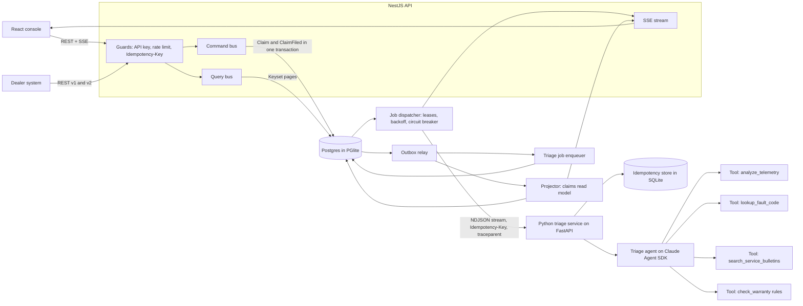

# Moto Warranty Triage

A warranty claims backend for an electric motorcycle maker: a versioned NestJS API runs a Python triage agent as a retried, idempotent background job, and a service engineer signs off every result.


Full video: https://github.com/ArchiusVuong-sudo/moto-warranty-triage/releases/download/v0.1/demo.mp4

## What it does

- A dealer files a claim with a ride-log export (10 minutes of 1 Hz telemetry and fault codes) through `POST /v2/claims`. Sending the same request again with the same `Idempotency-Key` returns the first `201` and never files a second claim.
- The claim goes to a Python triage agent in the background. The console shows each step live under one trace id: the event, the job, every attempt and every tool call the agent makes.
- The agent returns a root cause with evidence that cites telemetry windows, fault codes and service bulletins, plus parts and labour. Warranty coverage comes from a rules engine, not from the model.
- An engineer approves, edits or rejects the result. The decision is stored next to the model's suggestion, and the inbox updates without a reload.
- Fault drills show the distributed-systems paths working: kill the Python service mid-run, drop a reply after the result is stored, redeliver an event, file a corrupt export.
- An API inspector shows the headers that matter (cursor `Link`, `RateLimit-*`, `Retry-After`, `Deprecation`, `Sunset`), a 30-request burst against the dealer key, and the query plan of keyset pages next to `OFFSET`.

## Architecture



One command starts everything on port 4114. The API starts the Python service as a child process on a free loopback port and restarts it if it dies. `AI_SERVICE_URL` points the API at a service you run yourself instead.

## How it works

**The REST API (NestJS 12 on Express 5).** URI versioning: `/v2` is current and `/v1` is kept for old dealer tools. Every request needs a scoped API key (`claims:read`, `claims:write`, `triage:decide`, `ops`). Keys are stored only as HMAC-SHA256 hashes. A dealer key sees only its own dealer's claims, and another dealer's claim is a `404`, so the API does not confirm it exists. Every error is `application/problem+json`. OpenAPI for both versions is at `/docs`.

**Idempotency.** `POST /v2/claims` needs an `Idempotency-Key`. The claim, its ride log, the `ClaimFiled` event and the idempotency record commit in one transaction. The same key and body returns the stored `201` with `Idempotent-Replayed: true`. The same key with another body is a `422`. Keys are scoped per API key.

**Rate limits.** A token bucket per key (the dealer key allows a burst of 20, refilled at 1 per second). Every answer carries `RateLimit-Limit`, `RateLimit-Remaining` and `RateLimit-Reset`. A refusal is a `429` with `Retry-After`. The buckets live in memory; with more than one API node they would move to Redis.

**Pagination.** `/v2/claims` uses a keyset cursor on `(filed_at, claim_id)`, signed with HMAC and bound to the filters it was issued for. A tampered cursor, or one reused with other filters, is a `400`. New claims land in front of the cursor, so a client walking the pages sees no duplicates and no gaps while claims arrive (a test walks 1,200 claims while filing new ones). On page 301 of the 20,000 seeded claims, `EXPLAIN ANALYZE` shows the cursor query reading 50 rows from the index and `OFFSET 15000` reading 15,050. `/v1/claims` still answers with offset pages and the old field names, plus `Deprecation`, `Sunset` and `Link: rel="successor-version"`.

**Events and CQRS.** Commands write to the write model and append events to an outbox table in the same transaction. An outbox relay delivers each event to two consumers: the projector, which keeps the `claim_view` read model current, and the job enqueuer, which queues one triage job per claim. Delivery is at least once. Each consumer records the event id in `processed_events` inside its own transaction, so a redelivered event changes nothing (the drill shows both consumers ignoring it). The query bus reads only the read model, and the console gets read-model changes over SSE.

**The job queue.** Jobs are leased with `FOR UPDATE SKIP LOCKED` and a lease that a heartbeat extends; an expired lease is picked up again. Network errors, broken streams, `409` and `5xx` are retried with exponential backoff and full jitter, up to 6 attempts. A `422` or a result that breaks the contract is dead-lettered at once. A circuit breaker opens after 2 failures in a row. While it is open the dispatcher leases nothing, so no job spends an attempt on a service that is down, and a health probe (not a job attempt) closes it again.

**The Python service.** A FastAPI app wraps the agent the way an AI team would hand it over. It validates the request with pydantic and the ride log row by row (widths, time order, finite numbers), then streams NDJSON: `accepted`, one `span` per tool call, then `result` or `error`. The run is its own asyncio task, not the request's, and its result goes to a SQLite idempotency store keyed by the job's `Idempotency-Key`. If the reply is lost after the result is stored, the retry is served from the store with 0 new model runs. A run left half-done by a killed process is taken over by the next attempt.

**The agent.** Claude Agent SDK for Python with four read-only tools on an in-process MCP server: `analyze_telemetry` (stats and detected events such as a cell spread over 150 mV or a 9 g impact), `lookup_fault_code` (25 codes), `search_service_bulletins` (10 bulletins) and `check_warranty` (an 8-clause policy as code). The agent runs with no built-in tools (`tools=[]`), only those four allowed, `setting_sources=[]`, `skills=[]`, `strict_mcp_config=True`, a fresh temp `cwd`, no session persistence, `max_turns`, a budget cap, `permission_mode="dontAsk"` and a child environment built from an allowlist. A pytest asserts each of these. Overloaded, rate-limited and `5xx` model errors are retried with backoff, and live runs are capped per day.

**Guardrails.** The output is checked against one JSON Schema, `contracts/triage-result.v1.schema.json`, in the Python service and again in the Node API with ajv, so the AI and backend teams share one versioned contract that tests cover on both sides. Coverage is money, so the service replaces the model's warranty block with the rules' decision for the model's own root cause and says so in the run. No claim reaches Approved without an engineer's call with `If-Match` on the claim version; a stale version is a `412`.

**Evals.** Seven labelled scenarios, one per fault, are scored on root cause, warranty decision and clause, evidence that cites telemetry and a fault code, and whether the model's own warranty answer already matched the rules. The live run in `evals/live-report.json` (claude-sonnet-5-5, 11 Oct 2026) scored 7/7 on each check, with a mean latency of 10.6 s and $0.185 for all seven runs.

**Replay mode.** One provider seam with two sides: live (the SDK) and replay (answers recorded from real live runs into `fixtures/` by `npm run record:fixtures`, each with its date and model). Replay matches a request to a fixture by the SHA-256 of its ride log, so it only answers inputs it has really seen, and it re-applies the same contract check and rules. A test re-runs each recorded tool call and fails if a tool's output has drifted since recording.

**Trade-offs.** PGlite (Postgres compiled to WASM) keeps the demo to one command with no database server; it has one connection, so `SKIP LOCKED` is written for a real Postgres and simply serializes here. The outbox relay polls every 100 ms instead of using `LISTEN/NOTIFY` or a broker, which keeps delivery order and dedup easy to read. The circuit breaker and rate limiter are per process.

## Run it

Needs Node 22+, [uv](https://docs.astral.sh/uv/) and Python 3.12. A local Claude Code login (or `ANTHROPIC_API_KEY`) is only needed for live mode.

```bash
npm ci                 # Node workspaces: api and web
npm run setup          # uv sync for the Python service
npm run build          # web console, then the API
npm start              # live when a login or key is found, replay otherwise
npm run start:replay   # replay mode: no login, no key, no model calls
```

Open http://localhost:4114. API docs are at http://localhost:4114/docs. Settings come from the environment or an optional `.env` at the repo root (see `.env.example`).

| Variable | Default | What it does |
| --- | --- | --- |
| `PORT` | `4114` | API and console port (binds 127.0.0.1) |
| `DEMO_REPLAY` | unset | `1` forces replay mode |
| `TRIAGE_MODE` | auto | `live` or `replay` |
| `TRIAGE_MODEL` | `claude-sonnet-5-5` | Model for live runs (`claude-opus-5-5`, `claude-haiku-5-5` also work) |
| `ANTHROPIC_API_KEY` | unset | Use an API key instead of the local Claude Code login |
| `TRIAGE_MAX_LIVE_RUNS_PER_DAY` | `40` | Cap on live model runs |
| `TRIAGE_SPAN_DELAY_MS` | `1400` | Pause between replayed tool spans, so drills can land mid-run |
| `AI_SERVICE_URL` | unset | Use an external triage service instead of starting one |
| `AI_RESTART_DELAY_MS` | `6000` | Delay before the supervisor restarts a dead triage service |
| `DB_PATH` | `.data/pg` | PGlite folder, or `memory://` |
| `SEED_CLAIMS` | `20000` | Synthetic claims seeded into a new database |
| `CURSOR_SECRET`, `KEY_PEPPER`, `DEMO_KEY_SEED` | local values | Cursor signing, key hashing and demo key derivation |
| `DEMO_ENDPOINTS` | on | `0` hides `/demo/*`, which hands the console its synthetic keys |

Other commands: `npm run eval` (replay eval), `npm run eval:live` (fresh live runs, writes `evals/live-report.json`), `npm run record:fixtures` (re-record replay fixtures from live runs).

## Tests

```bash
npm test               # API (Vitest + supertest) and Python service (pytest), no network
npm run test:e2e       # builds, then Playwright runs the main flow in replay mode
npm run test:live      # opt-in: one real model run (LIVE=1)
```

- API, 55 tests: auth (`401`, `403`, `404` across dealers, `400` on a malformed claim id, hashed keys), idempotency (replay, `422` on a changed body, rollback), keyset pagination under concurrent inserts, tampered and mismatched cursors, v1 deprecation headers, the `429` burst, the outbox and inbox dedup, the dispatcher against a fake NDJSON service (retries, dead letters, contract violations, max attempts, the breaker spending no attempts, expired leases), `If-Match` and `412`, migration checksums, and unit tests for the cursor, backoff, breaker, token bucket and contract.
- Python service, 78 tests: every agent isolation option, the env allowlist, each tool with valid and invalid input, every warranty clause, ride-log validation, the shared contract, the guardrail, fixture labels and tool drift, the replay eval, and the HTTP service (stream order, idempotency store, lost reply, `409` while running, a run taken over after a crash).
- End to end, 2 tests: a dealer files a claim twice with one key, the agent's spans stream in, the engineer approves with an edit and the inbox row turns Approved; a corrupt export lands in the dead-letter list.

## Notes

- All data is synthetic and labelled so in the console: three invented bike models, 40 invented dealers, 6,000 vehicles with VINs that start with `DEMO`, 20,000 historical claims generated in SQL from fixed hashes, and 8 ride-log scenarios. Fault codes, bulletins, part numbers and the warranty policy are invented too.
- Limits: the agent sees a summary of the ride log through its tools, not raw signals; replay mode answers only the eight shipped ride logs; the rate limiter, breaker and SSE fan-out live in one process.
- Production would move to a Postgres server with `LISTEN/NOTIFY` or a broker (SQS, Kafka) in place of the polling relay, and Redis for rate limits and breaker state.
- It would add OAuth client credentials for dealer systems, key rotation, and OpenTelemetry export of the trace ids already passed from the API to the Python service, with alerts on queue depth, dead letters and model cost.
- It would grow the eval set with real labelled ride logs, run it in CI on every prompt or tool change, and route low-confidence results to a review queue.
